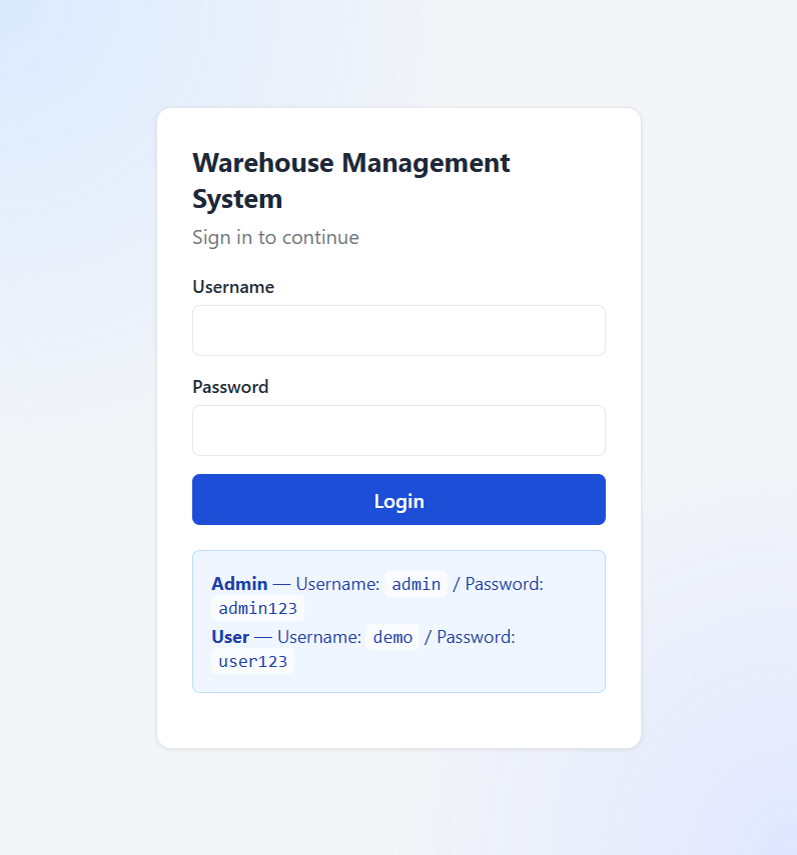
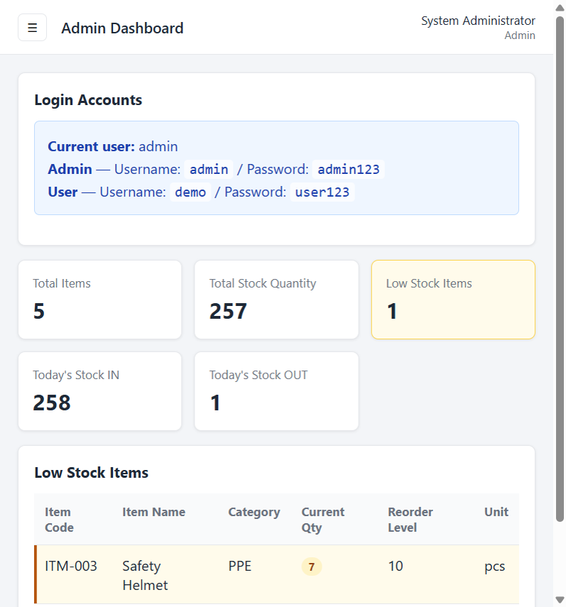
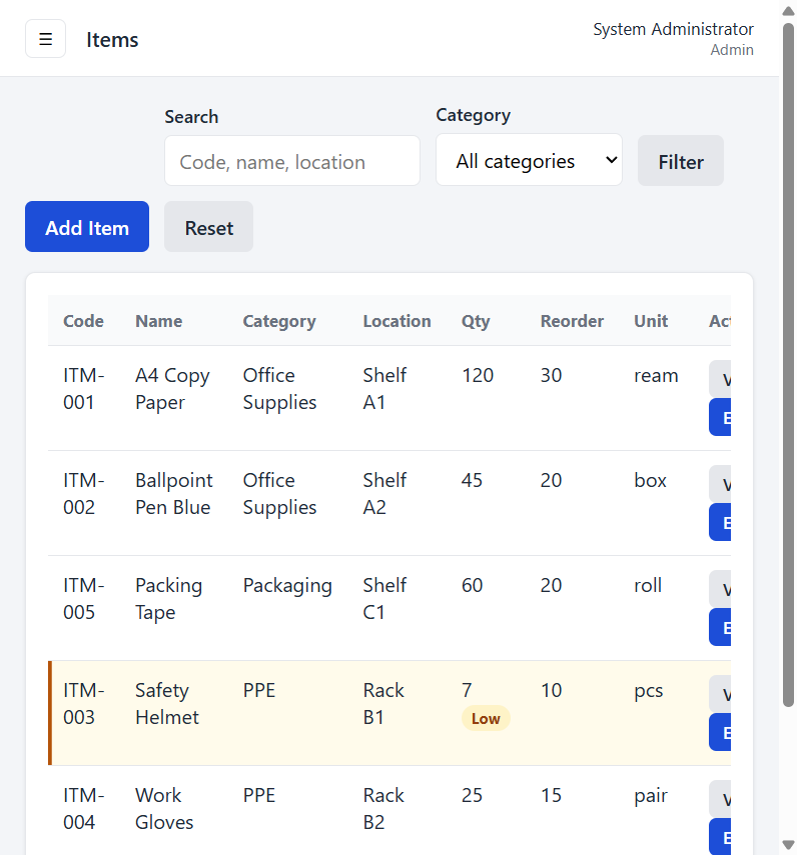
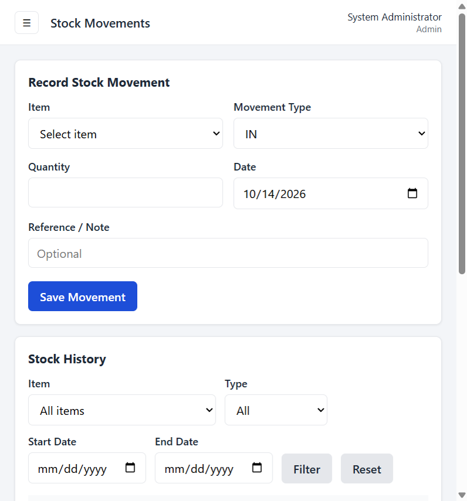
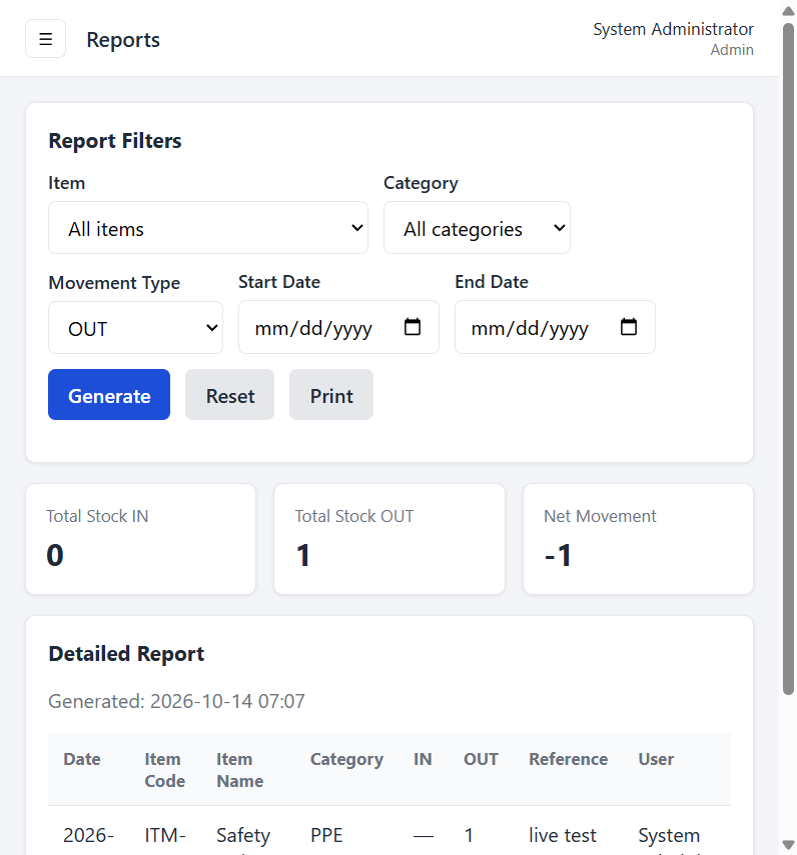
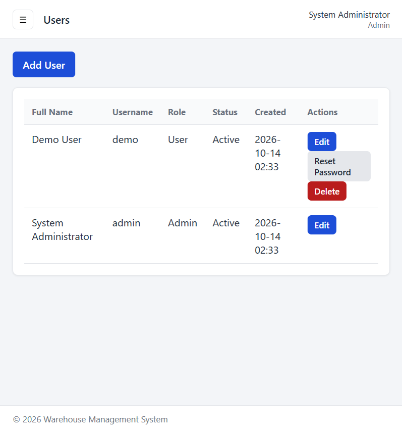

# Warehouse Management System

A simple, secure warehouse inventory application built with **PHP 8+**, **MySQL / MariaDB**, **PDO**, **HTML5**, **CSS3**, and **Vanilla JavaScript**.

Designed for **XAMPP** and **cPanel shared hosting**. No frameworks.

**Live demo:** [https://weihern.kolejsynergy.com/warehouse-cpanel/login.php](https://weihern.kolejsynergy.com/warehouse-cpanel/login.php)

---

## Screenshots

### 1. Login


### 2. Admin Dashboard


### 3. Items Management


### 4. Stock Movements


### 5. Reports


### 6. User Management


---

## Features

- Session-based login (`admin` / `user` roles)
- Item management (CRUD for admins)
- Stock IN / OUT with transactional row locking
- Stock history with filters
- Admin reports (printable)
- User management with password reset
- CSRF protection on all state-changing POST requests
- Login rate limiting
- Authenticated JSON item search API
- Responsive sidebar UI

---

## Requirements

- PHP 8.0+
- MySQL 8.0+ or MariaDB 10.4+
- Apache with `.htaccess` support

---

## Installation

### 1. Clone the repository

```bash
git clone https://github.com/weihern08/warehouse.git
cd warehouse
```

### 2. Configure the app

```bash
cp config/config.example.php config/config.php
```

Edit `config/config.php`:

```php
define('BASE_PATH', '/warehouse');
define('APP_URL', 'http://localhost/warehouse');
define('DB_HOST', 'localhost');
define('DB_PORT', '3306');
define('DB_NAME', 'your_database_name');
define('DB_USER', 'your_database_user');
define('DB_PASS', 'your_database_password');
```

On cPanel, use the **full** database name (often prefixed, e.g. `synergy1_weihern_warehouse`).

### 3. Import the database

1. Create a MySQL database and user in cPanel / phpMyAdmin
2. Grant the user **ALL PRIVILEGES** on that database
3. Select the database, then import `database/schema.sql`

> Do **not** run a `CREATE DATABASE` statement with a limited cPanel user. Select the existing database first, then import.

### 4. Open the app

```text
http://localhost/warehouse/login.php
```

---

## Default Demo Accounts

Seeded by `database/schema.sql` for testing only.

| Role  | Username | Password   |
|-------|----------|------------|
| Admin | `admin`  | `admin123` |
| User  | `demo`   | `user123`  |

**Change these passwords immediately after deployment.**

---

## Project Structure

```text
warehouse/
├── admin/                 # Admin-only pages
├── api/                   # Authenticated JSON endpoints
├── assets/                # CSS / JS
├── config/                # App + DB config (web-blocked)
│   └── config.example.php
├── database/              # schema.sql (web-blocked)
├── docs/screenshots/      # README screenshots
├── includes/              # Shared PHP helpers / layout
├── user/                  # Read-only user pages
├── index.php
├── login.php
├── logout.php
├── LICENSE
└── README.md
```

---

## Roles

### Admin

- Manage items
- Record stock IN / OUT
- View / filter stock history
- Generate and print reports
- Manage users

### User

- View dashboard
- Search / filter items
- View item details and stock history
- Cannot modify inventory or users

---

## Stock Movement Rules

- Every stock change creates a `stock_movements` row
- Movements use a database transaction and `SELECT ... FOR UPDATE`
- Stock OUT cannot exceed current quantity
- After creation, item quantity is updated only through movements

---

## API

`GET /api/items.php?q=search&limit=20`

Requires an authenticated session.

```json
{
  "success": true,
  "data": []
}
```

---

## Security Notes

- Passwords hashed with `password_hash()` / `password_verify()`
- PDO prepared statements
- Output escaped with `htmlspecialchars()`
- CSRF tokens on POST actions
- Login attempt limiting
- `/config` and `/database` blocked via `.htaccess`
- Keep real credentials in local `config/config.php` (not committed)

---

## License

This project is licensed under the [MIT License](LICENSE).
